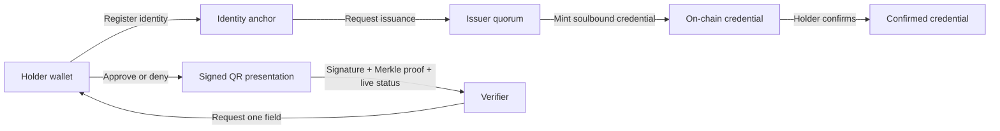
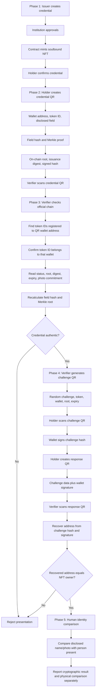

# VeriBind

### Wallet-bound credentials. Selective proof. No unnecessary disclosure.

VeriBind is a credential verification demo built around a simple trust rule:
the holder controls the credential, the institution issues it, and the
verifier receives only the fact they asked for.

The project combines a Solidity credential contract with a React interface,
Merkle proofs, wallet signatures, and QR presentations.

> **Demo status**
> MetaMask identity registration writes the holder's document fingerprint to
> the configured contract, and issuers can load registered wallet addresses
> from that contract. Credential issuance, consent notifications, and most
> lifecycle UI still use local demo state. A public deployment is not included.

## The trust flow



### What is proven

| Layer | Purpose |
| --- | --- |
| Wallet | Binds identity, consent, and presentation signing to an address |
| Issuer quorum | Requires the configured approval threshold before minting |
| Credential contract | Stores recipient, lifecycle status, issuance digest, Merkle root, and photo commitment |
| Merkle proof | Proves one selected field without exposing the full certificate |
| QR presentation | Carries the selected claim, proof, nonce, and holder signature |
| Fresh wallet challenge | Binds a new verifier session to a recipient wallet signature |
| Physical identity check | Requires the verifier to compare the disclosed name/photo with the person present |

## Verification phases

The verification flow uses three QR exchanges. The first QR carries the
credential presentation, the second carries a fresh challenge from the
verifier, and the third carries the holder's signed response.



### Phase 1: Credential issuance

1. The holder registers an identity anchor.
2. Authorized issuers approve the issuance request.
3. The contract mints a soulbound credential NFT to the holder wallet.
4. The holder confirms the credential, changing its status to `Confirmed`.

The contract stores the wallet recipient, credential status, Merkle root,
issuance digest, expiry, and photo commitment. Raw name and photo data are not
stored on-chain.

### Phase 2: Holder credential QR

The holder selects a field to disclose, such as `Name`. The holder app creates
the field hash locally and includes the Merkle proof needed to connect that
field to the certificate root.

The QR contains:

- Recipient wallet address
- NFT token ID
- Disclosed field value
- Disclosed field hash
- Merkle proof
- Certificate Merkle root
- Issuance digest and expiry
- Presentation `signedHash`
- Holder wallet signature

The holder signature covers a canonical representation of the presentation.
Changing any signed value causes the signed hash check to fail.

### Phase 3: Verifier on-chain check

The verifier does not trust the wallet address or token ID merely because they
appear in the QR. It queries the configured official contract and:

1. Searches the contract's holder-to-token index using the QR wallet address.
2. Confirms that the QR token ID belongs to that wallet.
3. Reads the live credential status, Merkle root, issuance digest, expiry, and
   photo commitment.
4. Recalculates the disclosed field hash.
5. Uses the Merkle proof to calculate a root.
6. Compares the calculated root with the on-chain root.
7. Verifies the presentation signed hash and holder signature.

The Merkle proof is not the Merkle root. The proof is the path of sibling
hashes used to calculate the root:

```text
disclosed field value -> field hash
field hash + Merkle proof -> calculated root
calculated root == on-chain certificate root
```

### Phase 4: Verifier challenge and holder response

After the initial credential QR passes, the verifier creates a fresh random
challenge QR. It includes the expected recipient address, token ID, contract,
chain, Merkle root, requested fields, and a short expiry.

The holder scans this challenge QR. The wallet signs the hash of the complete
challenge data. The holder then returns a response QR containing the challenge
and its signature.

The verifier recovers the signer address from:

```text
challenge hash + wallet signature -> recovered address
```

The address sent in the challenge is an expected value; it is not used to
derive the signer. The verifier checks both relationships:

```text
recovered address == expected address in challenge
expected address == NFT owner on-chain
```

This proves current control of the wallet bound to the credential. It does not
prove that the presenter is the real-world person named in the credential.

### Phase 5: Physical identity comparison

After cryptographic checks pass, the verifier displays the disclosed claims.
The officer or verifier compares the name and photo with the person physically
present. The result must remain separate:

```text
GREEN: Credential data authentic
GREEN: Presenter controls the credential wallet
YELLOW: Physical identity comparison required
```

Do not describe this as `100% identity verified` unless a separate trusted
government-ID, biometric, or liveness system has also completed verification.

## Features

- Wallet-based role routing for holders, issuers, and verifiers
- Holder identity registration with a document hash anchor
- Multi-approval institutional issuance
- Soulbound credential lifecycle: pending, confirmed, or disputed
- Holder-controlled share or deny decisions
- Field-level Merkle proofs for minimal disclosure
- MetaMask-signed QR presentations
- QR image import and payload validation
- Light and dark themes with responsive mobile layouts
- Developer flow debugger with runtime hashes, addresses, IDs, and state

Anyone can register a DID and inspect public blockchain data. Issuer access is
separate: an institution submits an accreditation certificate, government
registration certificate, or education-authority license reference. The
contract stores the evidence hash, and an authorized accreditation owner must
approve the issuer before it can mint credentials.

## Quick start

### Requirements

- Node.js 18 or newer
- npm
- MetaMask for real wallet signing

Install dependencies from the project root:

```powershell
npm install
npm --prefix frontend install
```

Compile and test the contract:

```powershell
npm run compile
npm test
```

Start the frontend:

```powershell
npm run frontend
```

Open the URL printed by Vite, usually `http://127.0.0.1:5173/`.

### Manual local RBAC test

To exercise the local fixture against actual contract state, use separate
terminals. The node terminal must stay open:

```powershell
npm run node
```

Deploy the contract and authorize two local issuer accounts. This does not
register holders or mint credentials; you perform those steps from the app:

```powershell
npm run deploy:local
```

Copy the printed contract address into `frontend/.env.local`:

```dotenv
VITE_OFFICIAL_CHAIN_ID=31337
VITE_VERIBIND_CONTRACT_ADDRESS=0xAddressPrintedByDeploy
```

Configure MetaMask with a local network using RPC `http://127.0.0.1:8545` and
chain ID `31337`. Import the two issuer accounts and three holder accounts
printed by Hardhat into MetaMask. The local deployment sets the issuance quorum
to 2; non-local deployments retain a quorum of 3.

1. Connect a holder account, register its identity, and approve the MetaMask
	transaction.
2. Repeat registration for any other holder accounts you want to test.
3. Connect Issuer 1, select a registered holder, and propose an issuance.
4. Approve the proposal with Issuer 1, switch wallet sessions, then approve it
	with Issuer 2.
5. Once both approvals are mined, finalize the issuance with either issuer.
	MetaMask mints a Pending NFT to the selected holder.
6. Switch to that holder account and confirm or dispute the credential in
	Review; MetaMask submits that status transaction.
7. Use any other wallet as a read-only verifier.

Start the frontend with `npm run frontend`. Debug reports chain reachability,
latest block, deployed contract address/code, and live credential IDs/status.
The app polls contract state so other clients connected to this same running
node and contract see mined updates.

Hardhat's printed accounts and private keys are public development fixtures.
Never import them on a real network or send real funds to them. The default
node listens only on the local machine. A Vercel-hosted page cannot reach that
local node from the public internet. Sharing it over a LAN requires exposing
the Hardhat RPC to that trusted LAN and configuring each device's MetaMask to
use the host computer's LAN address. For a trusted WiFi test, start a fresh
node with:

```powershell
npm run node -- --hostname 0.0.0.0
```

This starts a new empty local chain, so run `npm run deploy:local` again and
update the contract address in `frontend/.env.local`. In each device's MetaMask,
use `http://<host-computer-LAN-IP>:8545` as the RPC URL and chain ID `31337`.
For the Vercel build, set `VITE_OFFICIAL_CHAIN_ID=31337` and
`VITE_VERIBIND_CONTRACT_ADDRESS` to that deployment, then redeploy. This only
works for devices that can reach the host on the same LAN; the RPC is
unauthenticated and must never be exposed to the public internet.

For a production frontend build:

```powershell
npm run build
```

## Using the demo

1. Connect MetaMask or choose a local fixture wallet.
2. Upload a clear identity-document image, review the locally extracted name,
	then register the holder identity. With a configured deployment, MetaMask
	signs an on-chain registration containing only the document fingerprint.
3. Use the issuer workspace to reach the approval threshold and mint.
4. Return to the holder workspace and confirm the credential.
5. Ask for one field from the verifier workspace.
6. Open **Present**, connect the holder MetaMask account, and sign the QR.
7. Import the QR in **Verify** to inspect the validation result.
8. Generate a fresh challenge QR in **Verify**. The holder scans it in
	**Present**, signs it with the matching wallet, and returns the response QR.
9. Import the newly signed response QR before relying on wallet control.

The QR requires the holder wallet because it contains a cryptographic signature.
The verifier first checks the official contract, chain, Confirmed status,
recipient, issuance data, Merkle root, and selected proofs. For replay
resistance, the verifier can then generate a short-lived challenge QR containing
the chain, contract, token, recipient, root, requested fields, timestamp, and
expiry. The holder scans that QR, signs the challenge, and returns a new QR.

A valid QR proves credential authenticity and wallet control; it does not prove
that the presenter is the real-world person named in the credential. The
verifier must compare the disclosed name and photo with the person physically
present, or use a separate trusted identity/liveness process. VeriBind must not
claim that an NFT alone provides 100% physical identity verification.

Photos are not stored on-chain. The credential stores a `photoHash` commitment,
and the photo itself belongs in encrypted/off-chain storage. A disclosed photo
or secure reference must hash to that commitment and is still subject to a
physical comparison.

## Environment configuration

Copy the example file before configuring a live network:

```powershell
Copy-Item .env.example .env
```

Set these values when using on-chain identity registration and issuer discovery:

```dotenv
VITE_OFFICIAL_CHAIN_ID=11155111
VITE_VERIBIND_CONTRACT_ADDRESS=0xYourDeployedContract
VITE_DEMO_RECIPIENT_ADDRESS=0xCredentialRecipient
```

Deploy the current `VeriBindCredential` contract before using the issuer
recipient list. The issuer reads the contract's registered-holder index, so an
older deployment without `registeredHolderCount` and `registeredHolderAt`
must be redeployed. The chain stores the public wallet address, document
fingerprint, Merkle root, and photo commitment; names, raw photos, and other
profile fields are not written on-chain. Issuance from the current frontend
remains demo-local and does not submit contract transactions. Redeploy the
current contract before using a live environment because the `photoHash` field
and getter are part of the current ABI.

Deployment-only values such as `SEPOLIA_RPC_URL`, `DEPLOYER_PRIVATE_KEY`, and
`PINATA_JWT` belong in `.env` and must never be committed.

## Python environment

The application itself uses Node.js, Hardhat, and Vite. A project-local Python
environment is included for future scripts or tooling; it currently has no
required packages.

```powershell
.\.venv\Scripts\Activate.ps1
python --version
python -c "import sys; print(sys.executable)"
deactivate
```

## Project map

```text
contracts/                 Solidity credential contract
deployment/                Deployment manifest examples
fixtures(only demo data)/  Synthetic demo data
frontend/src/              React application and verification utilities
scripts/                   Hardhat deployment scripts
test/                      Contract tests
```

Important frontend modules:

- `frontend/src/App.tsx` - wallet flow, role views, QR generation, and UI state
- `frontend/src/lib/merkle.ts` - field hashing, roots, and proof verification
- `frontend/src/lib/presentation.ts` - signed presentation schema and checks
- `frontend/src/styles.css` - responsive theme and application styling

## Safety boundaries

- Never place private keys, AES keys, or production secrets in fixture files.
- Treat a QR as untrusted input until its signature, proof, contract, network,
  recipient, and credential status all pass validation.
- Do not treat a static QR as proof of current wallet presence. Use the fresh
	challenge flow when the verifier needs replay resistance.
- Do not display a single "100% identity verified" claim without a separate
	trusted biometric or government-ID verification process.
- Keep `.env` local. Only `.env.example` belongs in source control.

## License

This repository is a private demonstration project.
